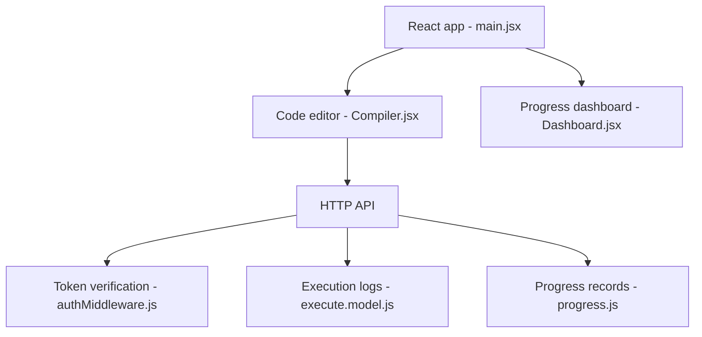

# JiyaBatra/CODEVIBE-

> Web platform for learning to code (C, HTML, CSS, SQL) with an online editor, grading and certificates, aimed at beginners.

## The problem
Learning to program without installing a local environment, with instant feedback.

## What it actually does
React frontend and Node/Express backend with MongoDB: structured courses, a code editor/compiler, grading (100 points per correct solution), a progress dashboard, multiple-choice exams, certificates and a "My Mistakes" board that ranks recurring errors. The README also lists API routes (auth, lessons, compilation, progress).

## How it is wired


## Trying it
```bash
cd client && npm install
cd ../server && npm install
cp server/.env.example server/.env
cd server && npm run dev
cd client && npm run dev
docker-compose up --build
```

## Cost and gotchas
Node 16+, MongoDB (local or Atlas) and a `JWT_SECRET` to generate. The README is uneven: it mentions SQL injection prevention even though the backend is MongoDB, and the `git clone` command in the Docker block is incomplete.

## What it is not
Not a proven product: v1.0.0, with many features still planned (collaboration, AI hints, mentors). Nothing says how user code is executed safely.

## Alternatives
The README only cites FreeCodeCamp as an inspiration, without presenting it as an alternative.

## For you
Ignore: a beginner educational project, unrelated to data or AI, and its code-execution security is not documented.
