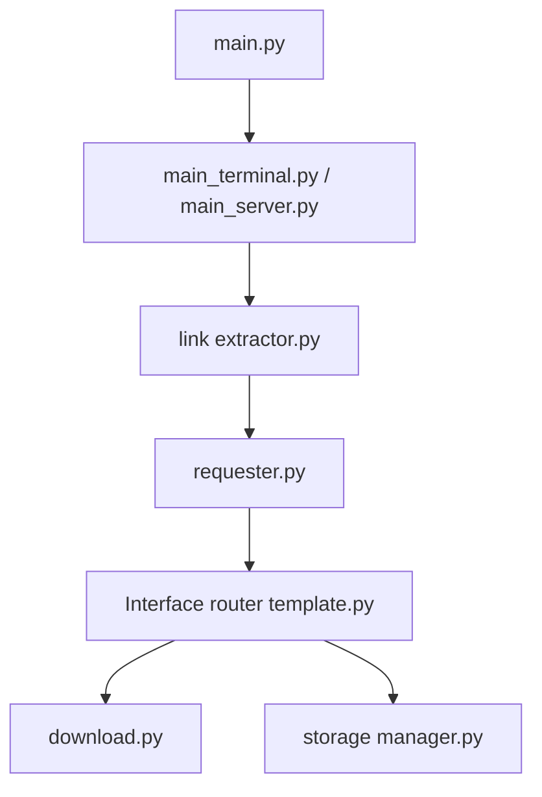

# JoeanAmier/TikTokDownloader

> Collector and downloader of Douyin and TikTok videos and metadata, via command line or API.

## The problem
Bulk-retrieving the videos, comments or statistics of Douyin and TikTok accounts is not covered by any official API.

## What it actually does
It downloads videos, galleries, lives (via ffmpeg), collections and favorites, incrementally and with resume after interruption.
It collects comments, searches, trends and account data, which it exports to CSV, XLSX or SQLite.
It runs in a terminal or as a Web API (`127.0.0.1:5555/docs`). The web interface is being reworked.
It generates the anti-bot tokens (xBogus, aBogus, msToken) and reads cookies.

## How it is wired

## Trying it
The README describes, in Chinese, the commands `uv sync --no-dev`, `uv run main.py`, `pip install -r requirements.txt` and `docker pull joeanamier/tiktok-downloader`, without a code block.

## Cost and gotchas
You must provide account cookies. The license is GPL-3.0. Compliance with the platforms' terms of service and with copyright is your responsibility.

## What it is not
It is not an official API: it depends on reverse engineering of signatures and may break at any time. It does not download paid content.

## Alternatives
The README cites Douyin_TikTok_Download_API (Evil0ctal) and f2 (Johnserf-Seed) as references.

## For you
Ignore: this is legally fragile scraping. Consider it only for a research dataset, after a real compliance review.
