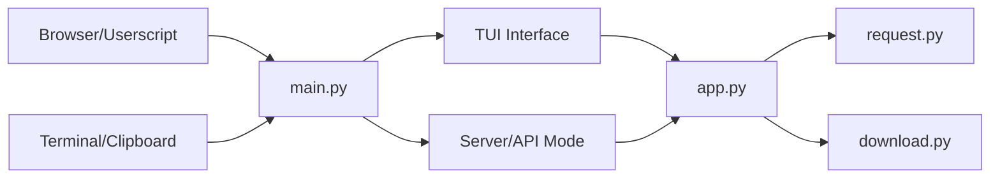

# JoeanAmier/XHS-Downloader

> Xiaohongshu (RedNote) content downloader as CLI, TUI, API or MCP, for archivers and scrapers.

## The problem
Retrieving images, videos and metadata from Xiaohongshu posts by hand is slow, and the platform offers no export.

## What it actually does
Extracts the info and download URLs of a post from its link, downloads files, covers and livePhoto, skips duplicates (ExploreID.db).
Three server modes: TUI, HTTP API (`/xhs/detail` on port 5556) and an MCP server for an AI assistant.
A Tampermonkey script extracts links (profile, favorites, search) and pushes the tasks to the program.
Configuration through `settings.json`: cookie, proxy, image format, file naming, optional SQLite.

## How it is wired


## Trying it
```bash
uv sync --no-dev
uv run main.py
docker pull joeanamier/xhs-downloader
```

## Cost and gotchas
Free; a Xiaohongshu cookie is sometimes needed, and older links are exposed to the platform's anti-bot check.
Python ≥ 3.12; reading the browser cookie on Windows requires administrator rights.

## What it is not
Not a general-purpose scraping tool: a single platform, a Chinese one.
GPL-3.0 and a very restrictive legal disclaimer (commercial use, copyright are on you).

## Alternatives
- JoeanAmier/TikTokDownloader: same author, for Douyin/TikTok.
- JoeanAmier/KS-Downloader: same author, for Kuaishou.

## For you
Ignore: only useful if you are building a Xiaohongshu corpus, and the legal framework of scraping there remains on you.
