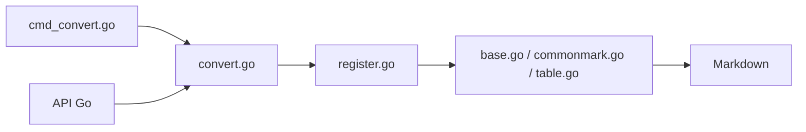

# JohannesKaufmann/html-to-markdown

> HTML to Markdown converter in Go, usable as a library or on the command line.

## The problem
Extracting clean text from web pages for RAG or archiving quickly yields broken Markdown.

## What it actually does
Parses the HTML, applies plugins (base, CommonMark, tables, strikethrough), handles escaping and whitespace. Options: domain to make links absolute, include and exclude selectors. UTF-8 input expected; does not sanitize untrusted content.

## How it is wired


## Trying it
```bash
go get -u github.com/JohannesKaufmann/html-to-markdown/v2
brew install JohannesKaufmann/tap/html2markdown
echo "<strong>important</strong>" | html2markdown
html2markdown --input file.html --output file.md
```

## Cost and gotchas
Free. The v2 CLI does not cover all options; several plugins are "planned".

## What it is not
Not a main-content extractor: excluding navigation is done with selectors. No encoding detection.

## Alternatives
None cited in the README (v1 remains on the "v1" branch).

## For you
A simple building block to prepare web corpora in Markdown, if you are comfortable with Go or a binary: adopt.
