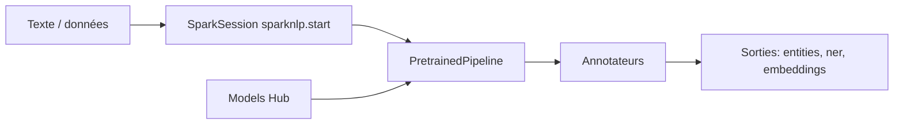

# JohnSnowLabs/spark-nlp

> Distributed NLP library on Apache Spark, with pre-trained models and pipelines, for JVM or Python data engineers.

## The problem
Applying NLP (NER, classification, translation, embeddings) to large volumes of text goes beyond what a single-machine library can do.

## What it actually does
NLP annotators integrated into Spark ML pipelines: tokenization, NER, classification, embeddings, translation, summarization, QA, ASR, images. Provides pre-trained pipelines and models (the README claims tens of thousands of models in over 200 languages), imported as ONNX and OpenVINO, usable offline. CPU, GPU, AArch64 and Apple Silicon variants (the last two "experimental").

## How it is wired


## Trying it
```bash
conda create -n sparknlp python=3.9 -y
conda activate sparknlp
pip install spark-nlp==7.0.0 pyspark==3.5.1
```
```python
spark = sparknlp.start()
pipeline = PretrainedPipeline('explain_document_dl', lang='en')
result = pipeline.annotate(text)
```

## Cost and gotchas
Free. Java 8/11 (Spark 3) or 17 (Spark 4), driver memory to tune (`sparknlp.start(memory="16G")`). The package matrix by Spark/Scala version must be respected.

## What it is not
Not a lightweight library: you need Spark. The claim "the only open source library in production" is marketing, not verifiable here. Models are downloaded from the hub.

## Alternatives
No alternative named in the README.

## For you
Watch: relevant if you already run Spark on large text corpora; otherwise the infrastructure overhead is not justified.
