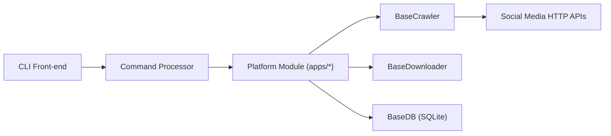

# Johnserf-Seed/f2

> Python library and CLI that download content from Douyin, TikTok, Twitter and Weibo.

## The problem
Bulk-retrieving videos, profiles, live streams and comments from social networks without a usable official API.

## What it actually does
One subpackage per platform (`apps/douyin`, `tiktok`, `twitter`, `weibo`, `bark`), each with `api`, `crawler`, `dl`, `db`, `filter`, `handler`, `model`. Shared base classes handle HTTP and WebSocket requests (httpx), downloading, SQLite (aiosqlite), YAML config, logs and i18n. It generates signatures (`XBogus`, `ABogus`, `msToken`) to get around protections, can record live streams and relay their comments, and notifies via Bark.

## How it is wired

## Trying it
The README only shows the table of contents: installation and commands point to the online documentation. No command is present in the material provided.

## Cost and gotchas
Free. Account cookies required for private content. The project is in "preview" and tracks platform API changes; config changes break older versions. Sponsor: TikHub, a paid service.

## What it is not
Not an official API: platform protections can make it inoperative. The README demands compliance with scraping rules and disclaims all liability.

## Alternatives
- TikHub: the sponsor's commercial API (700+ endpoints), paid.

## For you
Ignore: scraping social networks falls outside the scope of a data/AI/MLOps profile and exposes you to legal and blocking risks.
