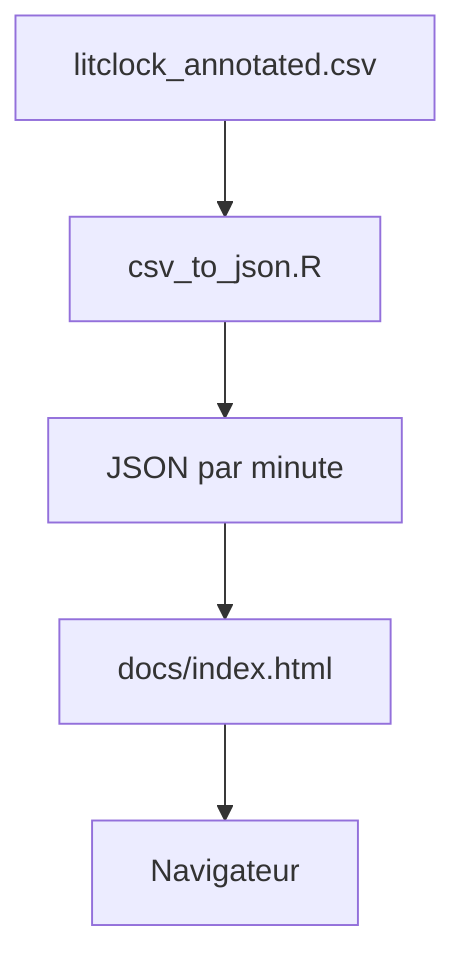

# JohsEnevoldsen/literature-clock

> Web clock that displays, every minute, a literary quotation containing the time, just for fun.

## The problem
A time display with no interest; the idea is to read the time through sentences taken from books.

## What it actually does
Static page in `docs/` that shows one quotation per minute. Light or dark theme via `?theme=`, filtering of sensitive quotations via `?sfw=true`. The quotations live in `litclock_annotated.csv`, converted to per-minute JSON with an R script.

## How it is wired


## Trying it
```bash
python3 -m http.server
```
Run it in `docs/`, or open `index.html` in Firefox.

## Cost and gotchas
Free. Converting the quotations requires R and the packrat package manager. Some quotations may be inappropriate.

## What it is not
Not a work tool: a curiosity. Not a reusable library.

## Alternatives
- litime: command-line tool that displays a quotation for the current time.

## For you
Ignore: nice project, but with no data, AI or MLOps use, and the license is not identified.
