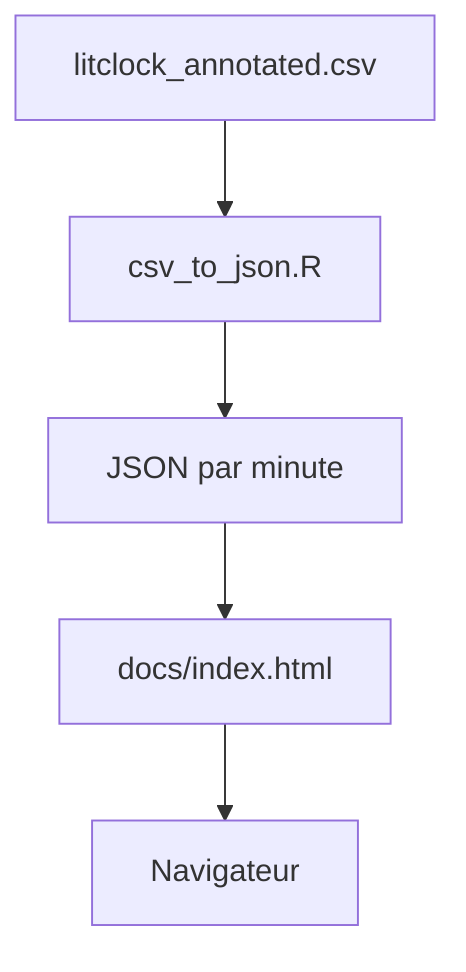

# JohsEnevoldsen/literature-clock

> Horloge web qui affiche à chaque minute une citation littéraire contenant l'heure, pour le plaisir.

## Le problème
Un affichage d'heure sans intérêt ; l'idée est de lire l'heure à travers des phrases tirées de livres.

## Ce que ça fait vraiment
Page statique dans `docs/` qui montre une citation par minute. Thème clair ou sombre via `?theme=`, filtre des citations sensibles via `?sfw=true`. Les citations vivent dans `litclock_annotated.csv`, converties en JSON par minute avec un script R.

## Comment c'est branché


## Essayer
```bash
python3 -m http.server
```
À lancer dans `docs/`, ou ouvrir `index.html` dans Firefox.

## Coût et pièges
Gratuit. La conversion des citations demande R et le gestionnaire de paquets packrat. Certaines citations peuvent être inappropriées.

## Ce que ce n'est pas
Pas un outil de travail : une curiosité. Pas une bibliothèque réutilisable.

## Alternatives
- litime : outil en ligne de commande qui affiche une citation à l'heure courante.

## Pour toi
À ignorer : joli projet, mais sans usage data, IA ou MLOps, et la licence n'est pas identifiée.

