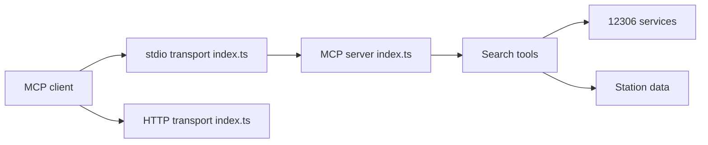

# Joooook/12306-mcp

> MCP server that lets a language model search for train tickets on 12306 (China).

## The problem
An AI assistant cannot directly query the Chinese railway service 12306.

## What it actually does
A TypeScript MCP server, over stdio or HTTP, exposing tools for ticket search, train filtering, looking up the stops of a route and finding transfers, with a station data resource. The code is concentrated in `src/index.ts`.

## How it is wired


## Trying it
```bash
npx -y 12306-mcp
npx -y 12306-mcp --port 8080
```

## Cost and gotchas
Free. Node 18+; depends on the 12306 service, outside your control. Docker available.

## What it is not
Not a booking tool: search only. The author states it is "for learning".

## Alternatives
An equivalent skill exists (Joooook/12306-skill, cited in the README).

## For you
Ignore: only useful for traveling in China; keep it as a simple example of a TypeScript MCP server.
