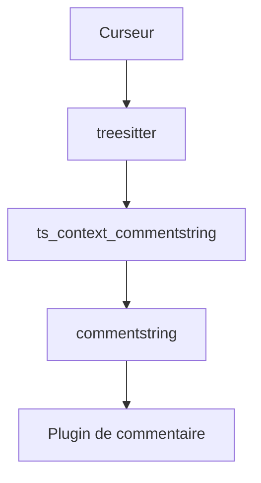

# JoosepAlviste/nvim-ts-context-commentstring

> Neovim plugin that sets `commentstring` according to the cursor position, for files with embedded languages.

## The problem
In a Vue or JSX file, each section has its own comment style. A single `commentstring` per buffer produces wrong comments.

## What it actually does
It queries treesitter to find out which section the cursor is in, then adjusts only the `commentstring` option. It adds no key mapping: you need a commenting plugin such as Comment.nvim or Neovim's built-in commenting. Without integration, the computation runs on `CursorHold`.

## How it is wired
Simplified diagram based on the sheet, no diagram provided.



## Trying it
```lua
require('lazy').setup {
  'JoosepAlviste/nvim-ts-context-commentstring',
}
require('ts_context_commentstring').setup {
  enable_autocmd = false,
}
```

## Cost and gotchas
Free. Requires Neovim 0.9.4 and installed treesitter parsers. Without integration, lower `updatetime` to 100 so the computation triggers.

## What it is not
It is not a commenting plugin: it only sets the option. No link with data or AI.

## Alternatives
No named alternative, except the commenting plugins to pair it with (Comment.nvim, vim-commentary).

## For you
Ignore: only useful if you edit mixed-language files in Neovim, with no direct relation to data, AI or MLOps work.
