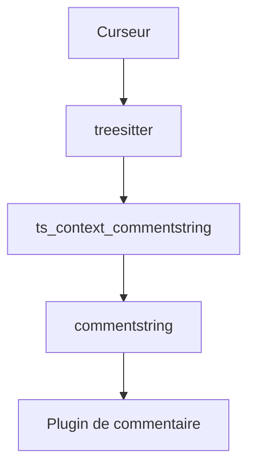

# JoosepAlviste/nvim-ts-context-commentstring

> Plugin Neovim qui règle `commentstring` selon la position du curseur, pour les fichiers à langages imbriqués.

## Le problème
Dans un fichier Vue ou JSX, chaque section a son propre style de commentaire. Un seul `commentstring` par tampon donne de mauvais commentaires.

## Ce que ça fait vraiment
Il interroge treesitter pour savoir dans quelle section se trouve le curseur, puis ajuste uniquement l'option `commentstring`. Il n'ajoute aucun raccourci : il faut un plugin de commentaire comme Comment.nvim ou le commentaire natif de Neovim. Sans intégration, le calcul se fait sur `CursorHold`.

## Comment c'est branché
Schéma simplifié d'après la fiche, sans diagramme fourni.



## Essayer
```lua
require('lazy').setup {
  'JoosepAlviste/nvim-ts-context-commentstring',
}
require('ts_context_commentstring').setup {
  enable_autocmd = false,
}
```

## Coût et pièges
Gratuit. Requiert Neovim 0.9.4 et des parsers treesitter installés. Sans intégration, baisser `updatetime` à 100 pour que le calcul se déclenche.

## Ce que ce n'est pas
Ce n'est pas un plugin de commentaire : il ne fait que régler l'option. Aucun lien avec la data ou l'IA.

## Alternatives
Aucune alternative nommée, sauf les plugins de commentaire à associer (Comment.nvim, vim-commentary).

## Pour toi
À ignorer : utile seulement si tu édites dans Neovim des fichiers à langages mêlés, sans rapport direct avec un travail data, IA ou MLOps.

