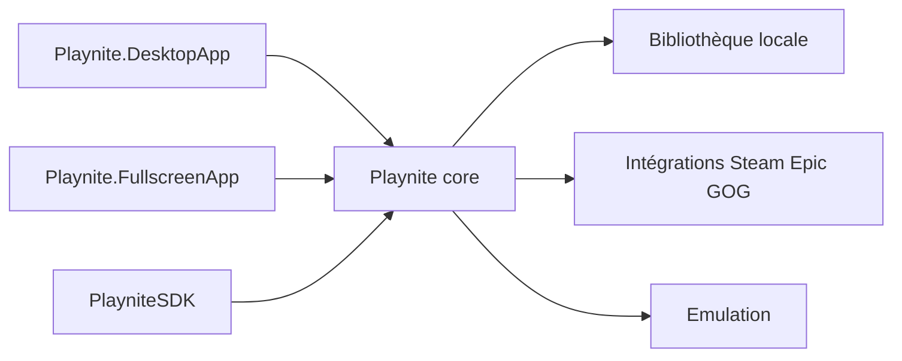

# JosefNemec/Playnite

> Windows game library manager and launcher, unifying Steam, Epic, GOG and emulators.

## The problem
Your games are scattered across several platforms and emulators.

## What it actually does
WPF application for Windows 10/11 with desktop and fullscreen interfaces, .NET plugins, PowerShell scripts, themes, third-party library integrations and emulator configurations. Library stored locally. The code is being rewritten for version 11 in a private repository; contributions are almost suspended.

## How it is wired

## Trying it
No command documented: installer or portable version from the download page.

## Cost and gotchas
Free (Patreon donation). Windows only. Code signing by SignPath.

## What it is not
Not a store or a cross-platform launcher.

## Alternatives
No alternative named in the README.

## For you
Ignore: a hobby outside your field; single maintainer and private rewrite under way.
