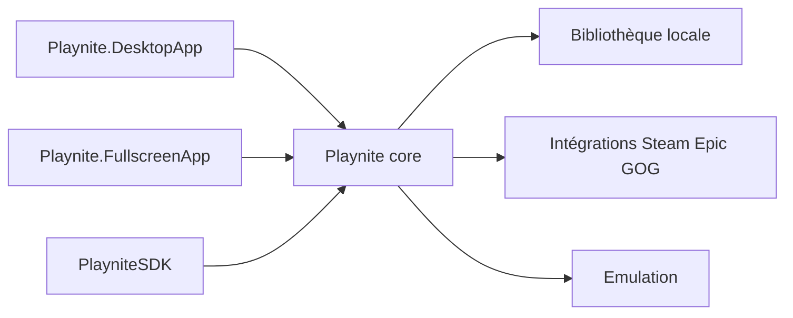

# JosefNemec/Playnite

> Gestionnaire et lanceur de bibliothèque de jeux Windows, unifiant Steam, Epic, GOG et émulateurs.

## Le problème
Ses jeux sont éparpillés entre plusieurs plateformes et émulateurs.

## Ce que ça fait vraiment
Application WPF Windows 10/11 avec interface bureau et plein écran, plugins .NET, scripts PowerShell, thèmes, intégrations de bibliothèques tierces et configurations d'émulateurs. Bibliothèque stockée localement. Le code est en cours de réécriture pour la version 11 dans un dépôt privé ; les contributions sont presque suspendues.

## Comment c'est branché

## Essayer
Aucune commande documentée : installateur ou version portable depuis la page de téléchargement.

## Coût et pièges
Gratuit (don Patreon). Windows seulement. Signature de code par SignPath.

## Ce que ce n'est pas
Pas un magasin ni un lanceur multiplateforme.

## Alternatives
Aucune alternative nommée dans le README.

## Pour toi
Ignorer : loisir hors métier ; mainteneur unique et réécriture privée en cours.

