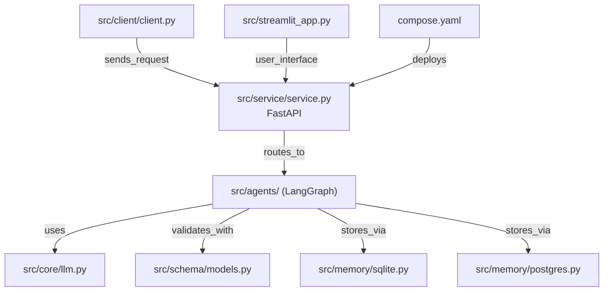

# JoshuaC215/agent-service-toolkit

> Complete service template to expose a LangGraph agent as an API and a chat interface.

## The problem
LangGraph gives you the graph, not the service: streaming, conversation history, moderation, client, interface and deployment all remain to be written before the first demo you can show.

## What it actually does
Assembles a LangGraph agent, a FastAPI service that serves it with and without streaming, a reusable client and a Streamlit chat app, with schemas and settings in Pydantic. Implements the LangGraph v1.0 features: `interrupt()` for human-in-the-loop, `Command` for flow control, `Store` for long-term memory, `langgraph-supervisor`. Several agents coexist and are called by URL path, with `/info` listing agents and models. Past conversations are listed through `/threads`, with a sidebar in Streamlit. Each agent is also served via the AG-UI protocol to plug in a compatible front end such as CopilotKit. Includes a ChromaDB RAG agent, moderation through Safeguard, a star-rating feedback linked to LangSmith, and unit and integration tests.

## How it is wired


## Trying it
```bash
git clone https://github.com/JoshuaC215/agent-service-toolkit.git && cd agent-service-toolkit
echo 'OPENAI_API_KEY=your_openai_api_key' >> .env
curl -LsSf https://astral.sh/uv/0.12.5/install.sh | sh
uv sync --frozen && source .venv/bin/activate
python src/run_service.py
streamlit run src/streamlit_app.py
docker compose watch
docker compose up --build
langgraph dev
./scripts/smoke_test.sh
```

## Cost and gotchas
At least one LLM key is mandatory; Safeguard moderation additionally requires a Groq key. `docker compose watch` requires Docker Compose ≥ v2.23.0. Touching `pyproject.toml` or `uv.lock` forces a rebuild. The Postgres/MongoDB checkpointers, the AG-UI endpoint and LangFuse tracing are not covered by CI: `scripts/smoke_test.sh` exists precisely for that, and checks that you have not silently fallen back to SQLite.

## What it is not
Not a framework: it is a template to copy and modify, and its file organization becomes yours. Not a multi-tenant product: authentication is only mentioned as a header environment variable. File credentials go through `privatecredentials/`, which is ignored by git.

## Alternatives
- PolyRAG: extends this toolkit with RAG over Postgres and PDFs.
- `alexrisch/agent-web-kit`: a Next.js front end instead of Streamlit.

## For you
The best starting point in the batch for shipping a LangGraph agent as a service, tests included.
