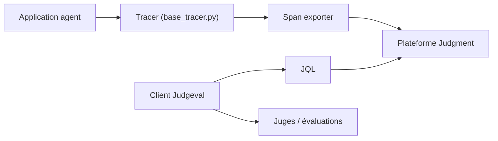

# JudgmentLabs/judgeval

> Python SDK for OpenTelemetry tracing and judge-based evaluation of LLM agents, linked to the Judgment platform.

## The problem
An agent in production fails in diffuse ways: you need to trace, classify failures and validate fixes on real cases.

## What it actually does
`@Tracer.observe()` captures inputs, outputs and tokens via OpenTelemetry; wrappers cover OpenAI, Anthropic, Google GenAI, Together, LangGraph, OpenLit and the Claude Agent SDK. Prompt-based judges, datasets, replayable evaluations, JQL queries over history, online monitoring and Slack alerts on the server side. Separate CLI and MCP server.

## How it is wired


## Trying it
```bash
pip install judgeval
export JUDGMENT_API_KEY=...
export JUDGMENT_ORG_ID=...
```
The README then gives `Tracer.init(project_name="my-project")` and `wrap(OpenAI())`.

## Cost and gotchas
A Judgment account (key + org) is required: traces are sent to their platform; pricing is not specified. The implementation path of online monitoring is not visible in the sampled code.

## What it is not
Not a 100% local tool: the SDK is open, the back end is a service.

## Alternatives
The README mentions OpenLit as an integration, not as a substitute.

## For you
Worth watching: good if you want agent tracing built on OpenTelemetry, provided you accept the dependency on the platform.
