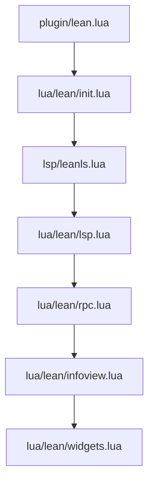

# Julian/lean.nvim

> Neovim plugin for the Lean theorem prover: infoview, unicode abbreviations, Loogle search.

## The problem
Writing Lean proofs outside VS Code requires full editor support.

## What it actually does
`plugin/lean.lua` loads `init.lua`, which reads the config, integrates elan and starts the language server. RPC responses feed an infoview (goals, terms, widgets) rendered by the tui layer. Adds unicode abbreviations, file progress, semantic highlighting, snippets and `:Telescope loogle`.

## How it is wired


## Trying it
```lua
vim.pack.add { "https://github.com/Julian/lean.nvim" }
vim.g.lean_config = { mappings = true }
```

## Cost and gotchas
Free. Real requirement: a recent Neovim (0.12 or nightly) and Lean. Image rendering requires a Kitty-compatible terminal and resvg for SVGs.

## What it is not
It is not Lean nor a proof assistant: only the Neovim integration.

## Alternatives
No alternative named in the README.

## For you
Ignore unless you do formal Lean proofs in Neovim, with no direct link to data / AI.
