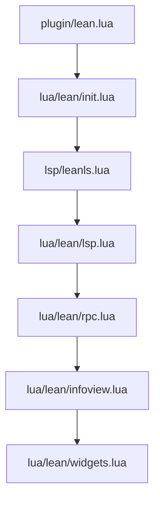

# Julian/lean.nvim

> Plugin Neovim pour le démonstrateur de théorèmes Lean : infoview, abréviations unicode, recherche Loogle.

## Le problème
Écrire des preuves Lean hors VS Code demande un support éditeur complet.

## Ce que ça fait vraiment
`plugin/lean.lua` charge `init.lua`, qui lit la config, intègre elan et démarre le serveur de langage. Les réponses RPC alimentent un infoview (buts, termes, widgets) rendu par la couche tui. Ajoute abréviations unicode, progression de fichier, sémantique colorée, snippets et `:Telescope loogle`.

## Comment c'est branché


## Essayer
```lua
vim.pack.add { "https://github.com/Julian/lean.nvim" }
vim.g.lean_config = { mappings = true }
```

## Coût et pièges
Gratuit. Besoin réel : Neovim récent (0.12 ou nightly) et Lean. Le rendu d'images exige un terminal Kitty-compatible et resvg pour les SVG.

## Ce que ce n'est pas
Ce n'est pas Lean ni un assistant de preuve : seulement l'intégration Neovim.

## Alternatives
Aucune alternative nommée dans le README.

## Pour toi
À ignorer sauf si tu fais des preuves formelles Lean sous Neovim, sans rapport direct avec la data / IA.

