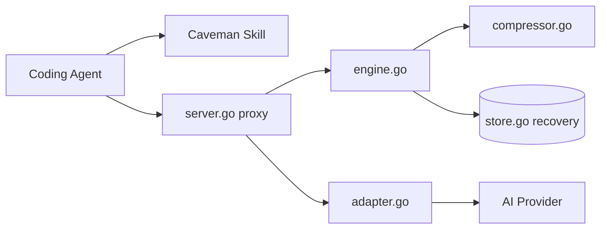

# JuliusBrussee/caveman

> Skills, proxies, and middleware that reduce the number of tokens written and read by a code agent.

## The problem
A code agent charges for each token: it writes verbose introductions and reads logs, test outputs, and full diffs.

## What it actually does
Three components:

*   **The Skill:** A rules file that instructs the agent to respond in a telegraphic style (using levels like `lite`, `ultra`, etc.), without modifying the code, commands, paths, or error messages.
*   **The Proxy:** A local server (`server.go`) that sits between the agent and the provider, compressing the text being read (`engine.go`, `compressor.go`) and preserving the original text for later retrieval (`store.go`).
*   **The Middleware:** A TypeScript or Python wrapper around the LangChain, Vercel AI SDK, OpenAI, or Anthropic calls.

The advertised gains (1.4 to 2.4x, according to an Adobe Research paper and a JetBrains test) come from the README: these are not verified here.

## How it is wired


## Trying it
```bash
npx skills add JuliusBrussee/caveman -g
npm install -g @caveman-ai/cli && caveman setup --install
caveman claude
```

## Cost and gotchas
The skill is running under MIT; the proxy runtime is under BSL-1.1. Complete installer: Node.js 22.13+; Python middleware: 3.13+, still in alpha.

## What it is not
A proxy that rewrites what the agent reads, not just a simple writing style: adding an intermediary to your calls is not insignificant. The middleware is in alpha. The README is not neutral: figures and rankings are used as arguments.

## Alternatives
No alternative is mentioned in the read-only part of the README (the "How it compares" section is truncated).

## For you
The skill is tested with a single command; the BSL proxy should be monitored before being used in real calls.
