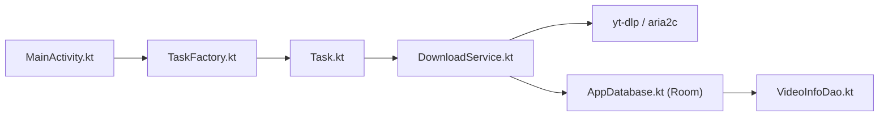

# JunkFood02/Seal

> Android app that downloads videos and audio via yt-dlp, for those who want a simple mobile interface.

## The problem
Using yt-dlp on a phone requires Termux and the command line. Without an interface, downloading playlists or subtitles stays painful on mobile.

## What it actually does
Seal is a Compose interface (single activity) on top of yt-dlp and, optionally, aria2c. A URL becomes a task, run by a foreground service, then recorded in Room. It handles playlists, subtitles, cookies, custom yt-dlp command templates and yt-dlp updates.

## How it is wired

## Trying it
No documented command: the README points to the APKs in the GitHub releases (arm64-v8a version recommended) or to F-Droid.

## Cost and gotchas
Free, no account. Two download paths coexist in the code (old and v2): the interface may change. 739 open issues.

## What it is not
Not an extraction engine: everything depends on yt-dlp, which breaks when platforms change. No iOS or desktop version.

## Alternatives
No alternative named in the README other than yt-dlp itself, of which Seal is the interface.

## For you
Ignore for a data / AI / MLOps profile: it is a consumer Android utility, unrelated to your processing pipelines, even though it is solid.
