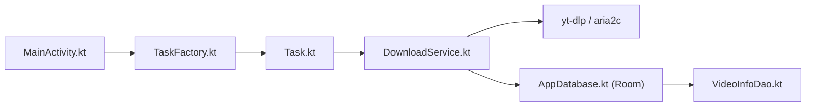

# JunkFood02/Seal

> Application Android qui télécharge vidéos et audios via yt-dlp, pour qui veut une interface mobile simple.

## Le problème
Utiliser yt-dlp sur un téléphone demande Termux et de la ligne de commande. Sans interface, le téléchargement de playlists ou de sous-titres reste pénible sur mobile.

## Ce que ça fait vraiment
Seal est une interface Compose (activité unique) au-dessus de yt-dlp et, en option, d'aria2c. Une URL devient une tâche, exécutée par un service au premier plan, puis historisée dans Room. Il gère les playlists, les sous-titres, les cookies, les modèles de commandes yt-dlp personnalisés et les mises à jour de yt-dlp.

## Comment c'est branché

## Essayer
Aucune commande documentée : le README renvoie aux APK des releases GitHub (version arm64-v8a conseillée) ou à F-Droid.

## Coût et pièges
Gratuit, aucun compte. Deux parcours de téléchargement coexistent dans le code (ancien et v2) : l'interface peut évoluer. 739 issues ouvertes.

## Ce que ce n'est pas
Ce n'est pas un moteur d'extraction : tout dépend de yt-dlp, qui casse quand les plateformes changent. Pas de version iOS ni desktop.

## Alternatives
Aucune alternative nommée dans le README en dehors de yt-dlp lui-même, dont Seal est l'interface.

## Pour toi
À ignorer pour un profil data / IA / MLOps : c'est un utilitaire Android grand public, sans lien avec tes chaînes de traitement, même s'il est solide.

