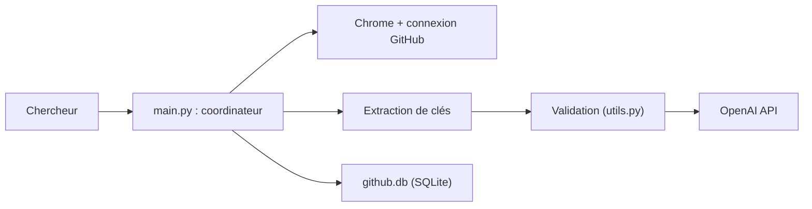

# Junyi-99/ChatGPT-API-Scanner

> Scans GitHub for valid OpenAI API keys, presented as a security research tool.

## The problem
API keys leak in public code; the tool tries to spot them.

## What it actually does
Drives Chrome via Selenium (GitHub web search with regex, by keywords and languages), extracts candidate keys, tests them against OpenAI and stores their status in a SQLite database `github.db`. Scan resumption, re-checking of keys already found, deduplication. The README notes that GitHub's push protection (2024) greatly reduces its effectiveness.

## How it is wired


## Trying it
```bash
git clone https://github.com/Junyi-99/ChatGPT-API-Scanner
cd ChatGPT-API-Scanner
uv sync
uv run main.py
```

## Cost and gotchas
Chrome and a GitHub account required; GitHub and OpenAI rate limits. Testing keys that are not yours may be illegal: the README warns against any unlawful use.

## What it is not
Not a defensive tool: it does not help protect your keys. The keys in the screenshots are expired.

## Alternatives
The README names no alternative; it only links to advice on good key management.

## For you
Ignore: an offensive tool whose use is legally delicate and of no value to a data/MLOps profile, for whom secret analysis is done with the platform's security tools.
