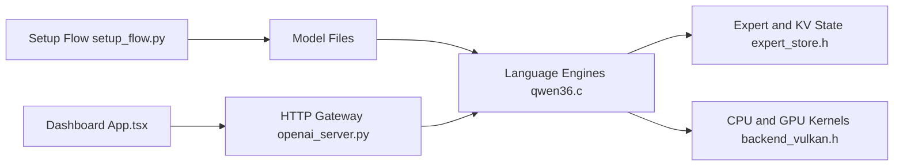

# JustVugg/colibri

> C language inference engine that allows for the execution of very large Mixture-of-Experts (MoE) models on standard hardware, without requiring a GPU.

## The problem
Models with hundreds of billions of parameters cannot fit into the VRAM or RAM of a standard computer.

## What it actually does
The dense part remains in RAM; the expert models are loaded from the disk on demand, with caching based on usage. A C file per model family (GLM, DeepSeek, Qwen, Kimi, MiMo…). Compatible with OpenAI and Anthropic, dashboard, optional Vulkan, CUDA, and Metal backends. Measured speeds range from 0.05 to 30 tokens/s, depending on the machine and model.

## How it is wired


## Trying it
```bash
sudo apt install git python3 build-essential
git clone https://github.com/JustVugg/colibri
cd colibri
./start-here.sh
./coli chat --model /nvme/qwen36
```

## Cost and gotchas
The smallest model requires a minimum of 8 GB of RAM and 22 GB of storage; larger models range from 167 GB to 1.56 TB. The storage capacity determines the speed: beyond a certain threshold (a few TB/s), you need serious hardware.

## What it is not
Not a high-performance tool on large datasets: 0.05 to 2 TOPS per second using only the CPU is typical. The README specifies that the author did not measure the performance of the discrete GPU.

## Alternatives
No alternative is mentioned in the README (only compatibility with the TypeSafe Jev API is cited).

## For you
Things to watch out for: A local OpenAI API for testing large models without a cluster is useful in MLOps, but the throughput is still too low for production use.
