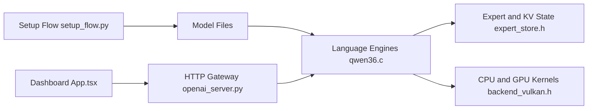

# JustVugg/colibri

> Moteur d'inférence en C qui fait tourner de très gros modèles MoE sur machine ordinaire, sans GPU obligatoire.

## Le problème
Les modèles de centaines de milliards de paramètres ne tiennent ni en VRAM ni en RAM d'un poste standard.

## Ce que ça fait vraiment
La partie dense reste en RAM ; les experts routés sont lus depuis le disque à la demande, avec un cache appris de l'usage. Un fichier C par famille de modèle (GLM, DeepSeek, Qwen, Kimi, MiMo…). Passerelle compatible OpenAI et Anthropic, tableau de bord, backends Vulkan, CUDA et Metal optionnels. Vitesses mesurées de 0,05 à 30 tok/s selon machine et modèle.

## Comment c'est branché


## Essayer
```bash
sudo apt install git python3 build-essential
git clone https://github.com/JustVugg/colibri
cd colibri
./start-here.sh
./coli chat --model /nvme/qwen36
```

## Coût et pièges
Minimum 8 Go de RAM et 22 Go de disque pour le plus petit modèle ; les gros modèles pèsent de 167 Go à 1,56 To. Le disque fixe la vitesse : au-delà de quelques tok/s, il faut du matériel sérieux.

## Ce que ce n'est pas
Pas un outil rapide sur gros modèle : 0,05 à 2 tok/s en CPU seul est courant. Le README précise que le GPU discret n'a pas été mesuré par l'auteur.

## Alternatives
Aucune alternative nommée dans le README (seule la compatibilité avec l'API Jev de TypeSafe est citée).

## Pour toi
À surveiller : une API OpenAI locale pour tester de grands modèles sans cluster est utile en MLOps, mais le débit reste trop faible pour de la production.

