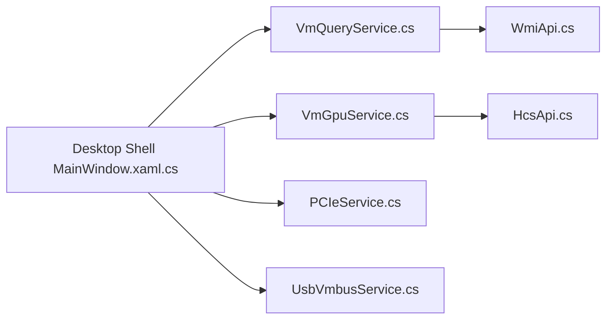

# Justsenger/ExHyperV

> Hyper-V graphical interface exposing GPU-PV, PCIe passthrough, USB and advanced networking.

## The problem
Hyper-V's advanced features (partitioned GPU, DDA, USB, CPU pinning) are hard to reach through PowerShell.

## What it actually does
WPF application built on WMI and the HCS API. Management of CPU/memory/storage, GPU-PV with driver injection (Windows, Linux via SSH), PCIe passthrough (DDA), USB via VMBus + USBIP, virtual switches, tree-shaped checkpoints ("Spacetime"), RDP console. The README also contains extensive Hyper-V documentation and GPU compatibility tables.

## How it is wired


## Trying it
```bash
cd src
dotnet build
```
(Or download the release and run `ExHyperV.exe`.)

## Cost and gotchas
Free; administrator rights and Hyper-V required; PCIe passthrough needs Windows Server and IOMMU. Several GPUs are listed with host crashes. The author flags untested scenarios.

## What it is not
Not a hypervisor: it drives Hyper-V. Hyper-V on ARM has no nested virtualization or DDA.

## Alternatives
No alternative named in the README.

## For you
Worth watching if you want GPU in a Windows VM for compute or testing; single maintainer, young project.
