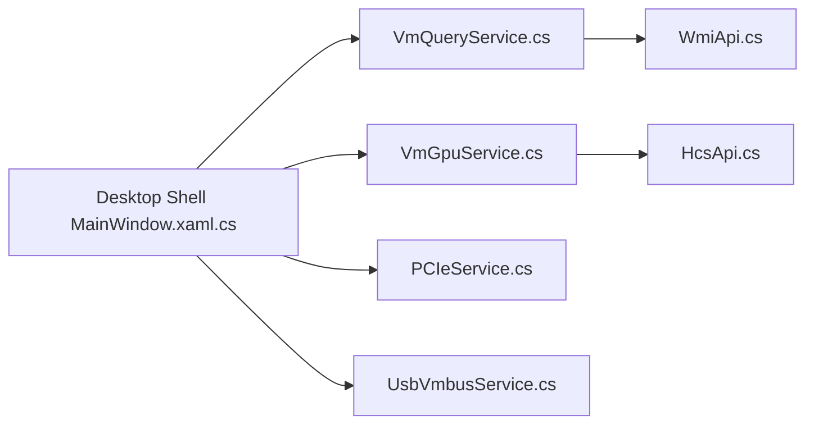

# Justsenger/ExHyperV

> Interface graphique Hyper-V exposant GPU-PV, passthrough PCIe, USB et réseau avancés.

## Le problème
Les fonctions avancées de Hyper-V (GPU partitionné, DDA, USB, CPU pinning) sont difficiles d'accès en PowerShell.

## Ce que ça fait vraiment
Application WPF s'appuyant sur WMI et l'API HCS. Gestion de CPU/mémoire/stockage, GPU-PV avec injection de pilotes (Windows, Linux via SSH), passthrough PCIe (DDA), USB via VMBus + USBIP, commutateurs virtuels, point de contrôle en arbre (« Spacetime »), console RDP. Le README contient aussi une longue documentation Hyper-V et des tables de compatibilité GPU.

## Comment c'est branché


## Essayer
```bash
cd src
dotnet build
```
(Ou télécharger la release et lancer `ExHyperV.exe`.)

## Coût et pièges
Gratuit ; droits administrateur et Hyper-V requis ; passthrough PCIe nécessite Windows Server et IOMMU. Plusieurs GPU listés avec plantages d'hôte. L'auteur signale des scénarios non testés.

## Ce que ce n'est pas
Pas un hyperviseur : il pilote Hyper-V. Hyper-V sur ARM sans virtualisation imbriquée ni DDA.

## Alternatives
Aucune alternative nommée dans le README.

## Pour toi
À surveiller si tu veux du GPU en VM Windows pour du calcul ou des tests ; mainteneur unique, jeune projet.

