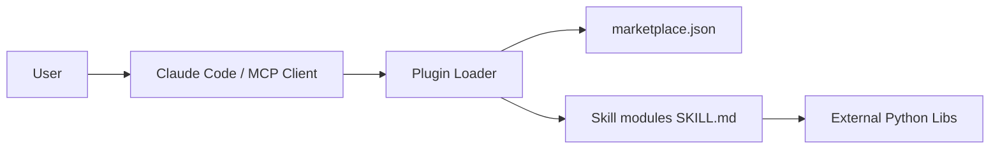

# K-Dense-AI/claude-scientific-skills

> Collection of 166 scientific skills for compatible agents. Agent Skills, for researchers and data scientists.

## The problem
An agent has limited knowledge of scientific APIs and specialized libraries, and the same instructions are constantly rewritten.

## What it actually does
There are `SKILL.md` files containing references and scripts: databases (a unified skill covers 78), Python packages (RDKit, Scanpy, scikit-learn, etc.), laboratory integrations, and writing tools. The repository also includes a plugin (`plugin.json` + `skills/`).

## How it is wired


## Trying it
```bash
gh skill install K-Dense-AI/scientific-agent-skills
gh skill install K-Dense-AI/scientific-agent-skills scanpy
gh skill update --all
```

## Cost and gotchas
The repository is free, but some skills require APIs (such as Benchling, Exa, and Modal), which necessitate a license. Installing all 166 skills can be resource-intensive: the README recommends using a subset.

## What it is not
This is not an application. The skills also come from community contributions, which are less frequently reviewed. The license for the repository (MIT, according to the README) is not listed in the catalog, and each skill has its own license.

## Alternatives
The README does not mention any direct alternatives. It refers to anthropics/skills, which is the source of the docx, pdf, pptx, and xlsx files.

## For you
Things to watch out for: Only install the skills that are actually needed (scikit-learn, statistics, visualization), and read the `SKILL.md` file before installing each one.
