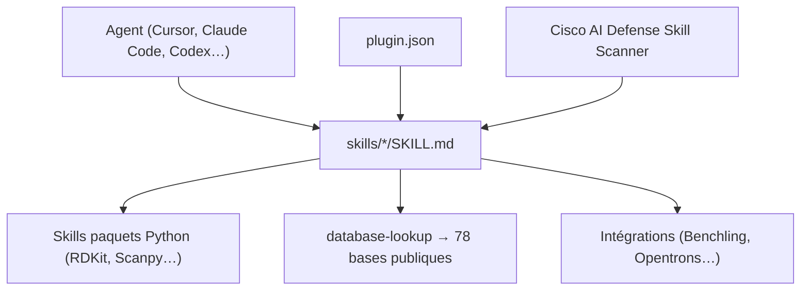

# K-Dense-AI/scientific-agent-skills

> A collection of 166 scientific skills for agents, ranging from genomics to geospatial analysis.

## The problem
An agent knows how to write Python, but struggles with the APIs of ChEMBL, Scanpy, or pydicom:
Each task begins with a thorough review of the documentation.

## What it actually does
Provides 166 skills to the standard Agent Skills, each with its `SKILL.md` file, code examples, use cases, and references. The repository also contains an Agent Plugins package (`plugin.json` + `skills/`).
Covers 78 public databases via a single `database-lookup` skill, plus DepMap, PrimeKG, and AlphaGenome;
70+ skills from Python packages (RDKit, Scanpy, PyTorch Lightning, scikit-learn, GeoPandas, Qiskit);
9 integration skills (Benchling, DNAnexus, Opentrons) and 30+ analysis and writing tools.
Any skill that provides `scripts/` must have a corresponding test suite, and the CI system will fail if it does not.

## How it is wired


## Trying it
```bash
gh skill install K-Dense-AI/scientific-agent-skills
gh skill install K-Dense-AI/scientific-agent-skills scanpy --agent claude-code
gh skill install K-Dense-AI/scientific-agent-skills --pin v2.66.0
npx skills add K-Dense-AI/scientific-agent-skills
uv pip install cisco-ai-skill-scanner && skill-scanner scan /path/to/skill --use-behavioral
```

## Cost and gotchas
The skills are free, but the services they refer to (Exa, Parallel, Benchling, NCBI) require keys. Python 3.13+ is required for the repository tools, and `uv` is also needed. The README itself warns:
a skill executes arbitrary code, and the team cannot review everything.

## What it is not
This is not an agent or a model; it is a set of instructions. It is not a guarantee of safety – contributions are reviewed "as best as possible." It is not intended to be installed all at once: 166 skills are significant in this context, and the README recommends a subset.

## Alternatives
- **anthropics/skills:** This section contains the source documents (docx, pdf, pptx, xlsx) for the skills listed here.

## For you
If you're dealing with biological information, it's best to analyze it in smaller subsets. Otherwise, ignoring the context can be very expensive.
