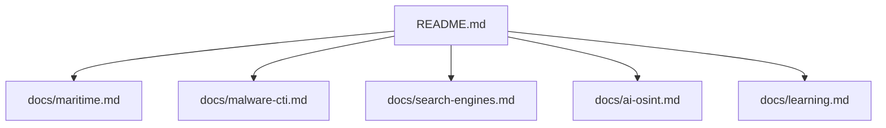

# K2SOsint/Legendary_OSINT

> Annotated list of open-source intelligence tools and resources, for investigators.

## The problem
OSINT tools are scattered across newsletters, Telegram groups and assorted repositories.

## What it actually does
The README serves as an index and points to guides by theme: people, aviation, maritime, rail, domains, phishing, malware, leaks, search engines, geospatial, media, images, video, companies, legal, academic research, intelligence feeds, automation, AI. Each guide lists third-party resources.

## How it is wired
The README is short, the diagram comes from the code diagram.

## Trying it
No command: it is a list of links. Open the repository README, pick a category and try the listed third-party tools one by one, first vetting each as the author asks.

## Cost and gotchas
Free. The listed tools are third-party: the author asks you to vet them before use. Some may be paid or require an account.

## What it is not
It is not a tool: no guarantee on the quality or legality of the listed resources.

## Alternatives
No alternative named in the README.

## For you
Worth watching: useful for threat monitoring or source verification, but only as an entry point to sort through.
