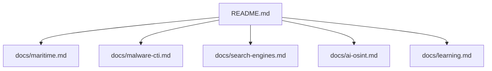

# K2SOsint/Legendary_OSINT

> Liste commentée d'outils et de ressources de renseignement en sources ouvertes, pour enquêteurs.

## Le problème
Les outils OSINT sont éparpillés entre newsletters, groupes Telegram et dépôts divers.

## Ce que ça fait vraiment
Le README sert d'index et renvoie vers des guides par thème : personnes, aviation, maritime, rail, domaines, phishing, malware, fuites, moteurs de recherche, géospatial, médias, images, vidéo, entreprises, juridique, recherche académique, flux de renseignement, automatisation, IA. Chaque guide liste des ressources tierces.

## Comment c'est branché
Le README est court, le schéma vient du diagramme du code.

## Essayer
Aucune commande : c'est une liste de liens. Ouvre le README du dépôt, choisis une catégorie et teste les outils tiers listés un par un, en vérifiant d'abord chacun comme le demande l'auteur.

## Coût et pièges
Gratuit. Les outils listés sont tiers : l'auteur demande de les vérifier avant usage. Certains peuvent être payants ou exiger un compte.

## Ce que ce n'est pas
Ce n'est pas un outil : aucune garantie sur la qualité ou la légalité des ressources listées.

## Alternatives
Aucune alternative nommée dans le README.

## Pour toi
À surveiller : utile pour la veille menaces ou la vérification de sources, mais seulement comme point d'entrée à trier.

