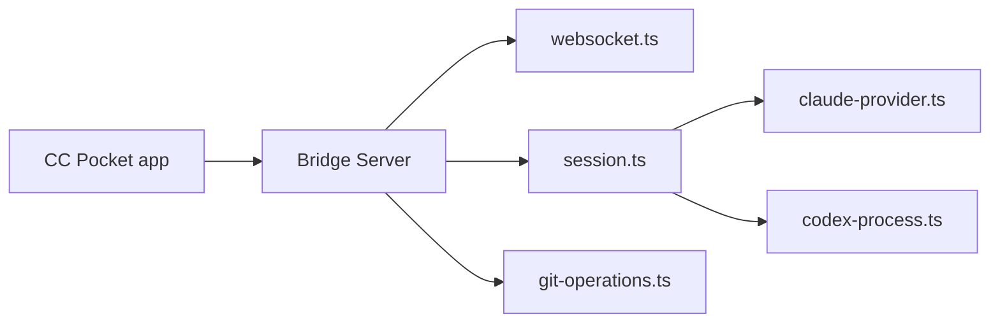

# K9i-0/ccpocket

> Mobile and desktop client to drive Codex and Claude from a phone via a local "Bridge" server.

## The problem
Launching, approving and reviewing a coding agent's work forces you to stay in front of the machine that hosts it.

## What it actually does
A Bridge server (npm) runs on your machine, drives the Codex or Claude CLIs and relays sessions, approvals, files, git diffs and worktrees to the app. Connection by QR code, mDNS or Tailscale; messages are queued offline. The code stays on your machine.

## How it is wired


## Trying it
```bash
npx @ccpocket/bridge@latest
```
```bash
npx @ccpocket/bridge@1 setup
```

## Cost and gotchas
Claude uses `ANTHROPIC_API_KEY` by default; subscription authentication requires `BRIDGE_ALLOW_CLAUDE_OAUTH=1`, whose scope is unclear according to the README. Optional "Supporter" purchases in the app.

## What it is not
Not cloud hosting for an agent. Not affiliated with Anthropic or OpenAI. Linux and Windows remain experimental.

## Alternatives
No alternative named in the README.

## For you
Worth watching: handy for following an agent remotely, but exposing a Bridge requires careful access control (Tailscale); MIT.
