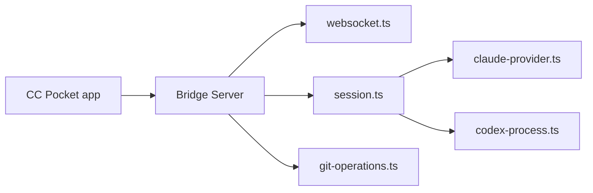

# K9i-0/ccpocket

> Client mobile et bureau pour piloter Codex et Claude depuis un téléphone via un serveur « Bridge » local.

## Le problème
Lancer, approuver et relire le travail d'un agent de code oblige à rester devant la machine qui l'héberge.

## Ce que ça fait vraiment
Un serveur Bridge (npm) tourne sur ta machine, pilote les CLI Codex ou Claude et relaie sessions, approbations, fichiers, diffs git et worktrees à l'application. Connexion par QR code, mDNS ou Tailscale ; messages en file hors ligne. Le code reste sur ta machine.

## Comment c'est branché


## Essayer
```bash
npx @ccpocket/bridge@latest
```
```bash
npx @ccpocket/bridge@1 setup
```

## Coût et pièges
Claude utilise `ANTHROPIC_API_KEY` par défaut ; l'authentification par abonnement exige `BRIDGE_ALLOW_CLAUDE_OAUTH=1`, de portée floue selon le README. Achats « Supporter » optionnels dans l'application.

## Ce que ce n'est pas
Pas un hébergement cloud d'agent. Non affilié à Anthropic ni OpenAI. Linux et Windows restent expérimentaux.

## Alternatives
Aucune alternative nommée dans le README.

## Pour toi
À surveiller : pratique pour suivre un agent à distance, mais exposer un Bridge demande de soigner l'accès (Tailscale) ; MIT.

