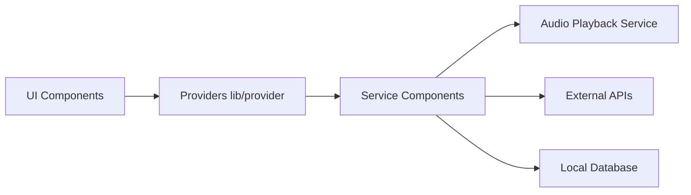

# KRTirtho/spotube

> A multi-platform music streaming application that can be extended with plugins for handling various sources and metadata.

## The problem
Streaming services dictate their terms to both their clients and their content providers; we would like to be able to integrate our own catalogs.

## What it actually does
Client for Windows, macOS, Linux, Android, and iOS. The plugins provide metadata, playlists, and audio sources. Tracks can be downloaded with tags, synchronized lyrics, and local playback control. No telemetry is collected. The installation table and the compilation section are reduced to empty links in the provided text.

## How it is wired
Diagram provided: Flutter layers, generics.


## Trying it
```bash
brew tap krtirtho/apps
brew install --cask spotube
```

## Cost and gotchas
Free. Its legality depends on the sources it connects to (YouTube, Piped, etc.): this is your responsibility. An AppImage has been removed due to instability. New versions are released every 3-4 months.

## What it is not
This is not a music service; it relies on third-party plugins. The README file is largely a list of dependencies.

## Alternatives
No alternative is specified in the README file.

## For you
To ignore: consumer-facing applications that have no connection to data or AI.
