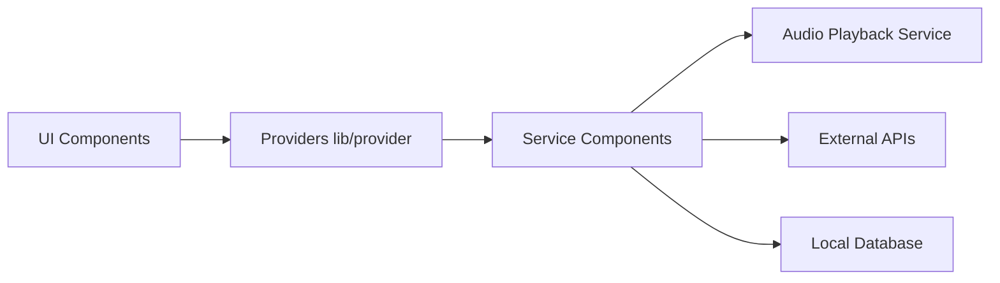

# KRTirtho/spotube

> Application de streaming musical multiplateforme extensible par plugins pour sources et métadonnées.

## Le problème
Les services de streaming imposent leur client et leurs sources ; on voudrait brancher ses propres catalogues.

## Ce que ça fait vraiment
Client Flutter pour Windows, macOS, Linux, Android, iOS. Les plugins fournissent métadonnées, playlists et sources audio. Téléchargement de pistes avec balises, paroles synchronisées, lecture pilotée localement. Annonce aucune télémétrie. Le tableau d'installation et la section de compilation sont réduits à des liens vides dans le texte fourni.

## Comment c'est branché
Diagramme fourni : couches Flutter, génériques.


## Essayer
```bash
brew tap krtirtho/apps
brew install --cask spotube
```

## Coût et pièges
Gratuit. Sa légalité dépend des sources que les plugins branchent (YouTube, Piped, etc.) : à ta charge. Un AppImage a été retiré pour instabilité. Version tous les 3-4 mois.

## Ce que ce n'est pas
Pas un service de musique : il dépend de plugins tiers. Le README est en grande partie une liste de dépendances.

## Alternatives
Aucune alternative nommée dans le README.

## Pour toi
À ignorer : application grand public sans rapport avec la data/IA.

