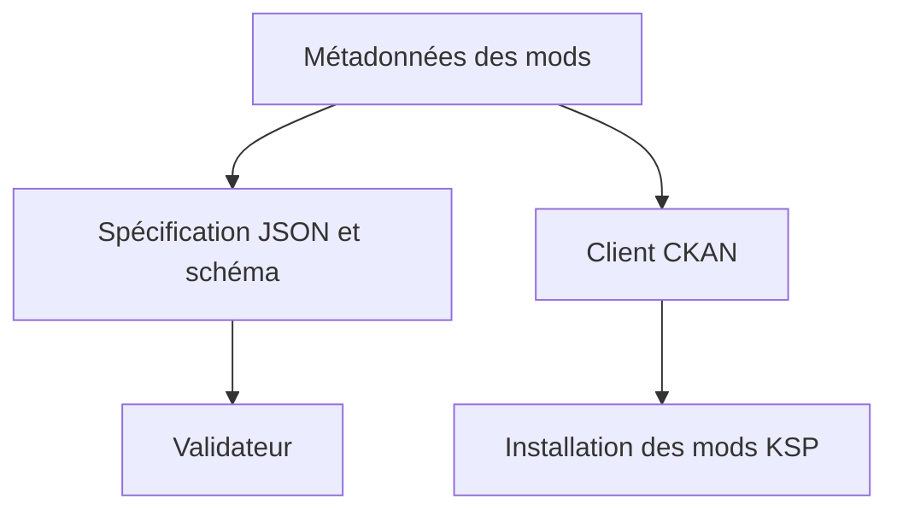

# KSP-CKAN/CKAN

> Mod manager for Kerbal Space Program, with verified dependencies and conflicts, for players and modders.

## The problem
Installing KSP mods by hand leads to bad installations, incompatible versions and conflicts.

## What it actually does
A metadata repository (JSON specification with schema and validator) plus tools to find, install and update mods, with their dependencies, for the right game version. Inspired by the Debian and CPAN formats.

## How it is wired
Simplified diagram based on the sheet, no diagram provided.

## Trying it
No command in the README; it points to the user guide.

## Cost and gotchas
Free. Requires the game Kerbal Space Program. The README does not describe how to install the client.

## What it is not
Not a general-purpose package management tool: specific to KSP.

## Alternatives
No alternative named in the README.

## For you
Ignore: unrelated to data / AI work, unless you play KSP.
