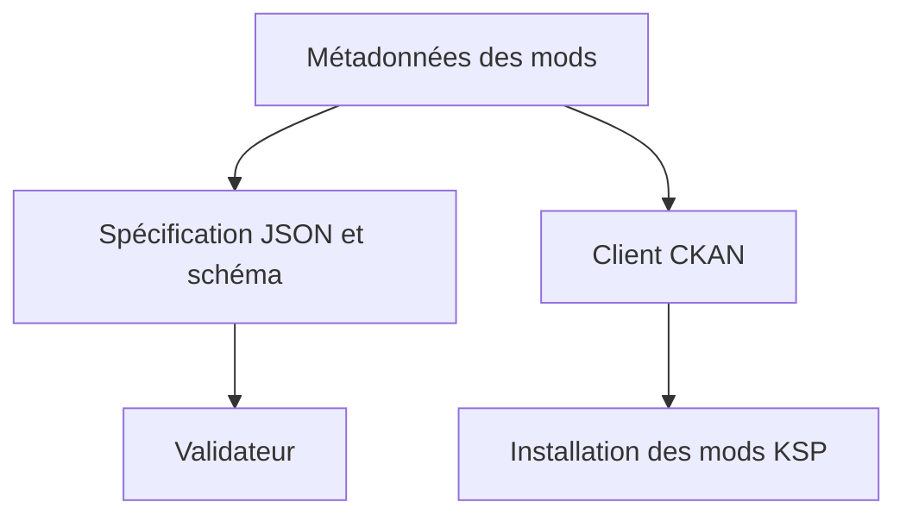

# KSP-CKAN/CKAN

> Gestionnaire de mods pour Kerbal Space Program, avec dépendances et conflits vérifiés, pour joueurs et moddeurs.

## Le problème
Installer à la main des mods de KSP provoque des mauvaises installations, des versions incompatibles et des conflits.

## Ce que ça fait vraiment
Dépôt de métadonnées (spécification JSON avec schéma et validateur) plus des outils pour trouver, installer et mettre à jour des mods, avec leurs dépendances, pour la bonne version du jeu. Inspiré des formats de Debian et CPAN.

## Comment c'est branché
Schéma simplifié d'après la fiche, sans diagramme fourni.

## Essayer
Aucune commande dans le README ; il renvoie au guide utilisateur.

## Coût et pièges
Gratuit. Nécessite le jeu Kerbal Space Program. Le README ne décrit pas l'installation du client.

## Ce que ce n'est pas
Pas un outil généraliste de gestion de paquets : propre à KSP.

## Alternatives
Aucune alternative nommée dans le README.

## Pour toi
Ignorer : sans rapport avec le travail data / IA, sauf si tu joues à KSP.

