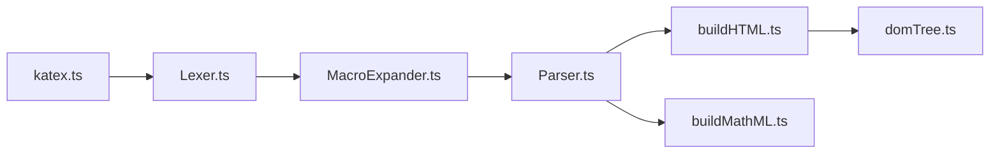

# KaTeX/KaTeX

> Synchronous TeX formula rendering in JavaScript, for the web or server side.

## The problem
Display math cleanly on a web page without reflow or heavy dependencies.

## What it actually does
`katex.render` writes a formula into a DOM element; `katex.renderToString` returns HTML (server-side rendering possible). Internally: lexer, macro expansion, parser, then HTML and MathML builders. Extensions: auto-render, copy-tex, mhchem. Covers a large part of LaTeX, not all of it.

## How it is wired


## Trying it
```js
katex.render("c = \\pm\\sqrt{a^2 + b^2}", element, {
    throwOnError: false
});
var html = katex.renderToString("c = \\pm\\sqrt{a^2 + b^2}", {
    throwOnError: false
});
```

## Cost and gotchas
Free. You must include the CSS stylesheet and the fonts, even for server rendering. 397 open issues.

## What it is not
Not a LaTeX compiler: only formulas, and only a subset of the functions.

## Alternatives
No alternative named in the README (it mentions a competitor through a speed test without naming it).

## For you
Handy for displaying formulas in reports, exported notebooks or web dashboards; fast rendering with no dependencies, adopt.
