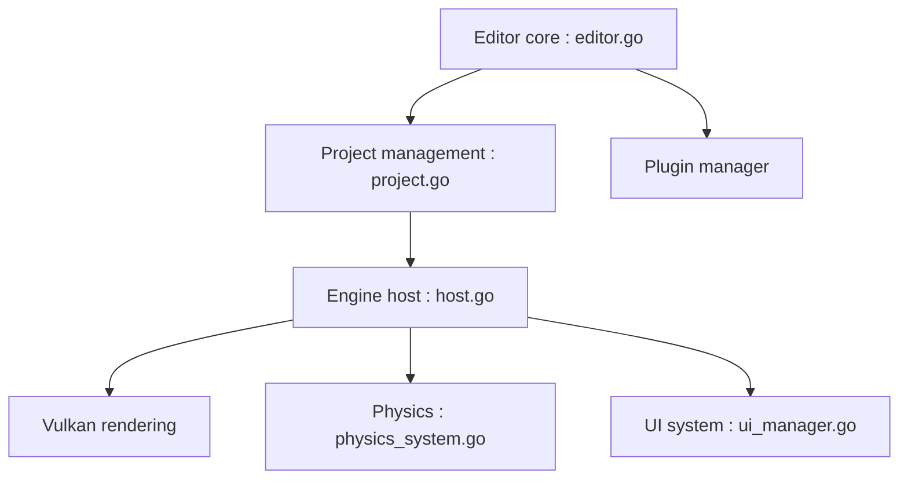

# KaijuEngine/kaiju

> 2D/3D game engine written in Go on Vulkan, with a built-in editor.

## The problem
Making games with an engine in a simple systems language rather than C++ or C#.

## What it actually does
A Go engine with Vulkan rendering, physics, audio (Soloud), animation, a home-made UI with an HTML/CSS option, terrain, Lua scripts and Go editor plugins. The editor is itself a game running in the engine. Targets: Windows, Linux, Mac, Android. The author states himself that the editor is not ready.

## How it is wired


## Trying it
```bash
git clone --recurse-submodules https://github.com/KaijuEngine/kaiju.git
mkdir bin/
cd src
go build -tags="debug,editor,filedrop" -o ../bin/ ./
```

## Cost and gotchas
Free. You need Go, C tools, platform libraries and Vulkan. On Windows, MinGW DLLs may be missing. The README's FPS figures are the author's own measurements.

## What it is not
Not a proven engine: "work in progress", editor not ready. License not identified.

## Alternatives
The README compares itself to Unity, Unreal and Godot without offering them as detailed alternatives.

## For you
Ignore: no link to data/AI/MLOps, and a young project carried by one person.
