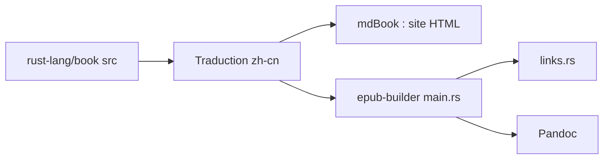

# KaiserY/trpl-zh-cn

> Simplified Chinese translation of the book "The Rust Programming Language", with export tools.

## The problem
Chinese-speaking readers need the official Rust book in their own language, kept up to date with the source.

## What it actually does
Contains the translation (2024 edition completed) aligned with rust-lang/book, with the official link and the commit hash at the top of each chapter. It builds into an mdBook site, a PDF (mdbook-typst-pdf), an EPUB (via a Rust tool and Pandoc) or GitBook. Part of the proofreading is assisted by Codex.

## How it is wired


## Trying it
```bash
cargo install mdbook
mdbook build
mdbook serve
```

## Cost and gotchas
Free. Rust is required to build; Pandoc for the EPUB. In case of divergence from the official site, the upstream `src` folder is the reference.

## What it is not
Not the original text nor an interactive course. Chinese only.

## Alternatives
No alternative named in the README.

## For you
Ignore unless you read Chinese and are learning Rust: no direct relation to data/AI.
