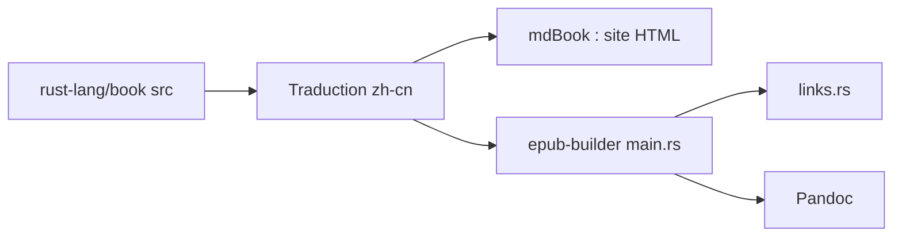

# KaiserY/trpl-zh-cn

> Traduction en chinois simplifié du livre « The Rust Programming Language », avec outils d'export.

## Le problème
Les lecteurs sinophones ont besoin du livre officiel Rust dans leur langue, à jour avec la source.

## Ce que ça fait vraiment
Contient la traduction (édition 2024 terminée) alignée sur rust-lang/book, avec en tête de chapitre le lien officiel et le hash de commit. Se construit en site mdBook, PDF (mdbook-typst-pdf), EPUB (via un outil Rust et Pandoc) ou GitBook. Une partie de la relecture est assistée par Codex.

## Comment c'est branché


## Essayer
```bash
cargo install mdbook
mdbook build
mdbook serve
```

## Coût et pièges
Gratuit. Rust requis pour construire ; Pandoc pour l'EPUB. En cas de divergence avec le site officiel, le dossier `src` upstream fait référence.

## Ce que ce n'est pas
Pas le texte original ni un cours interactif. En chinois uniquement.

## Alternatives
Aucune alternative nommée dans le README.

## Pour toi
À ignorer sauf si tu lis le chinois et apprends Rust : sans rapport direct avec data/IA.

