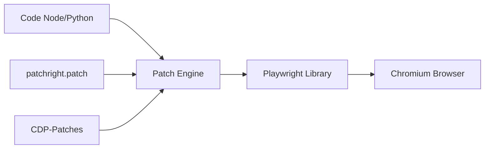

# Kaliiiiiiiiii-Vinyzu/patchright

> Modified version of Playwright for Chromium, designed to reduce the automation signals that sites can detect.

## The problem
A browser driven by Playwright exposes automation hints, which skews tests and data collection on sites that detect them.

## What it actually does
This repository contains the patched driver; it is used as a drop-in replacement for Playwright via the Python or Node packages. The README describes fixes for debugging-protocol signals, for default launch arguments and for access to closed shadow roots. Only Chromium is affected. The browser console is disabled. The lists of "passed tests" come from the author.

## How it is wired


## Trying it
```bash
# Aucune commande dans ce README (dépôt du pilote) :
# il renvoie aux paquets Python, NodeJS et .NET.
```

## Cost and gotchas
Free. The README displays proxy sponsors with promo codes. Bugs remain possible: the Playwright test suite does not fully pass, and fixes follow Playwright updates with a lag of a few days.

## What it is not
Not a classic testing tool: its goal is to make automation less detectable. Its use must respect the law and the terms of the targeted sites; the README presents it as educational, with no warranty or liability.

## Alternatives
- Playwright: the original, for tests with no need for stealth.
- CDP-Patches: a complementary project cited in the README.

## For you
Worth watching: relevant for legitimate tests or data collection on sites that block automation; check your right of access first.
