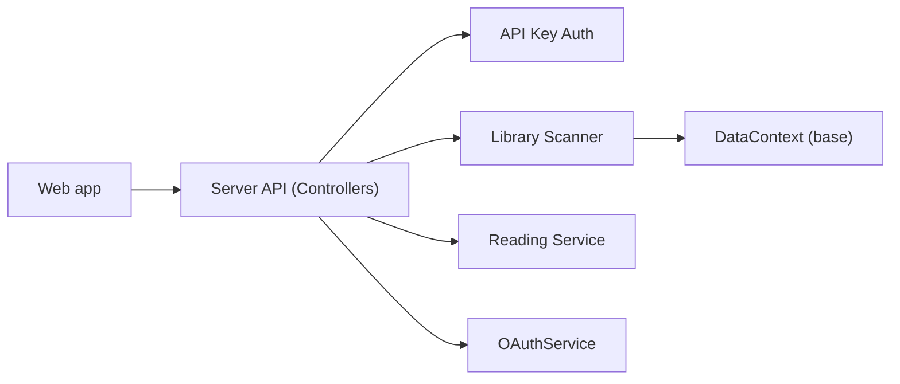

# Kareadita/Kavita

> Self-hosted reading server for manga, comics and books.

## The problem
A scattered collection of comics, manga and epubs has no common interface and no reading tracking.

## What it actually does
Serves cbr, cbz, zip/rar, 7zip, images, epub and pdf with suitable web readers (webtoon, continuous mode). Manages users and roles (OIDC, age restrictions), collections, reading lists, epub annotations. The library scanner feeds a database; scrobbling and advanced metadata go through Kavita+, a paid subscription.

## How it is wired

## Trying it
No command in the README; it points to the wiki (getting-started).

## Cost and gotchas
Server is free; Kavita+ is paid (internet). The README says "beta" before 1.0: data loss is possible.

## What it is not
Does not provide content. The metadata and review features depend on the Kavita+ service.

## Alternatives
No alternative named in the README.

## For you
Unrelated to data/AI: ignore unless for personal reading use.
