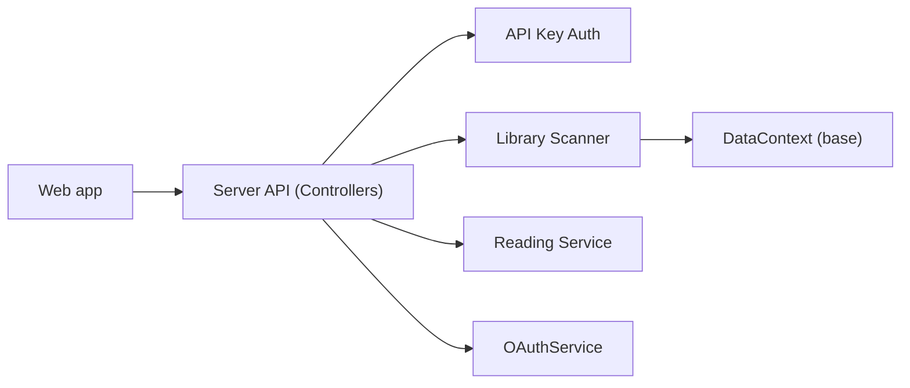

# Kareadita/Kavita

> Serveur de lecture auto-hébergé pour mangas, bandes dessinées et livres.

## Le problème
Une collection de BD, mangas et epub dispersée n'a pas d'interface commune, ni de suivi de lecture.

## Ce que ça fait vraiment
Sert cbr, cbz, zip/rar, 7zip, images, epub et pdf avec des lecteurs web adaptés (webtoon, mode continu). Gère utilisateurs et rôles (OIDC, restrictions d'âge), collections, listes de lecture, annotations epub. Le scanner de bibliothèque alimente une base ; scrobbling et métadonnées avancées passent par Kavita+, abonnement payant.

## Comment c'est branché

## Essayer
Aucune commande dans le README ; il renvoie au wiki (getting-started).

## Coût et pièges
Serveur gratuit ; Kavita+ payant (internet). Le README dit « bêta » avant la 1.0 : perte de données possible.

## Ce que ce n'est pas
Ne fournit pas de contenu. Les fonctions de métadonnées et d'avis dépendent du service Kavita+.

## Alternatives
Aucune alternative nommée dans le README.

## Pour toi
Sans rapport avec data/IA : à ignorer sauf pour un usage personnel de lecture.

