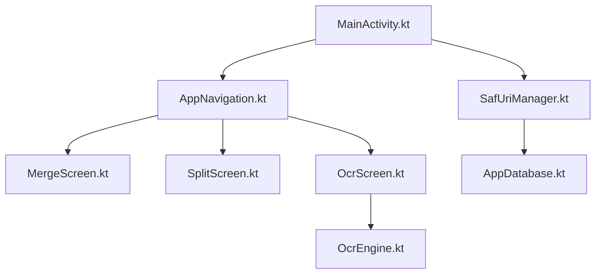

# Karna14314/Pdf_Tools

> Offline Android application to merge, split, annotate and sign PDFs, for the general public.

## The problem
Handling a PDF on a phone often means going through an online service that receives the document.

## What it actually does
Merge, split, compression, reordering, rotation, image and PDF conversions, camera scanning, annotation, signature, password, watermark, OCR. Everything runs on the device, with no internet permission. Three build variants: playstore (ML Kit), fdroid and opensource (Tesseract).

## How it is wired
Simplified diagram based on the sheet, with the diagram provided.



## Trying it
```bash
git clone https://github.com/Karna14314/Pdf_Tools.git
cd Pdf_Tools
./gradlew assembleFdroidRelease
```

## Cost and gotchas
Free. Building requires Android Studio Hedgehog or later, JDK 17+ and Android SDK 26+. Several links between screens are marked unverified in the architecture.

## What it is not
Neither a reusable library nor a server-side batch processing tool. A single maintainer, 23 open issues.

## Alternatives
No alternative named in the README.

## For you
Ignore: consumer mobile application, unrelated to data, AI or MLOps work.
