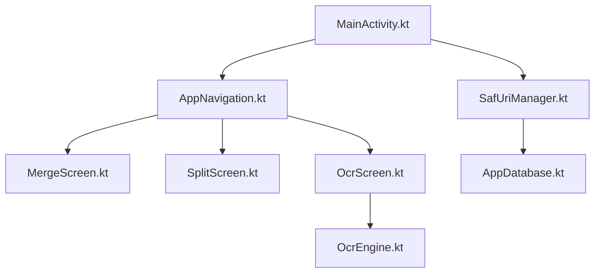

# Karna14314/Pdf_Tools

> Application Android hors ligne pour fusionner, découper, annoter et signer des PDF, pour le grand public.

## Le problème
Manipuler un PDF sur téléphone oblige souvent à passer par un service en ligne qui reçoit le document.

## Ce que ça fait vraiment
Fusion, découpe, compression, réordonnancement, rotation, conversions images et PDF, scan par caméra, annotation, signature, mot de passe, filigrane, OCR. Tout tourne sur l'appareil, sans permission internet. Trois variantes de build : playstore (ML Kit), fdroid et opensource (Tesseract).

## Comment c'est branché
Schéma simplifié d'après la fiche, avec le diagramme fourni.



## Essayer
```bash
git clone https://github.com/Karna14314/Pdf_Tools.git
cd Pdf_Tools
./gradlew assembleFdroidRelease
```

## Coût et pièges
Gratuit. La compilation exige Android Studio Hedgehog ou plus, JDK 17+ et Android SDK 26+. Plusieurs liens entre écrans sont marqués non vérifiés dans l'architecture.

## Ce que ce n'est pas
Ni une bibliothèque réutilisable, ni un outil de traitement par lot côté serveur. Un seul mainteneur, 23 issues ouvertes.

## Alternatives
Aucune alternative nommée dans le README.

## Pour toi
À ignorer : application mobile grand public, sans lien avec un travail data, IA ou MLOps.

