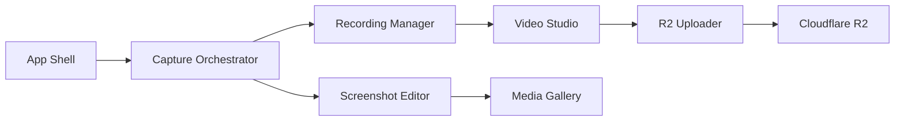

# KartikLabhshetwar/better-shot

> Open-source macOS app for screen capture, screen recording and editing, for people who document or demo.

## The problem
Capturing, annotating, recording and then editing a demo usually takes several tools, often paid or requiring an account.

## What it actually does
- Region, window or full-screen captures, OCR, color picker, annotations (arrows, blur, text).
- Screen recording with audio, microphone, camera, teleprompter; editing (cuts, speed from 0.25× to 8×, zooms, subtitles, 3D shots).
- MP4/MOV export; optional sharing to your own Cloudflare R2 bucket, credentials stored in the Keychain.
- Actions can be driven through the `bettershot://` URL scheme.

## How it is wired


## Trying it
```bash
brew install --cask bettershot
open 'bettershot://capture/region'
```

## Cost and gotchas
Free, no BetterShot account. Requires macOS 26 or later, and several system permissions (screen recording, accessibility, microphone, camera). Sharing requires your own Cloudflare account; links are public to anyone who holds them, and the app contacts GitHub for updates.

## What it is not
Not a security tool despite its presence in this batch: nothing in the README makes it offensive. No Windows/Linux version. The diagram notes that some links in the schema are inferred from the README, not from the code.

## Alternatives
No alternative named in the README.

## For you
Ignore: a macOS desktop utility with no link to data or MLOps, except for recording demos; worth remembering only if you are on a recent Mac.
