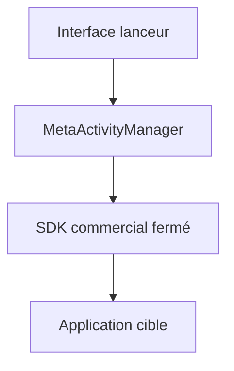

# Katana-Official/SPatch-Update

> Android launcher interface for an app container, whose full SDK is commercial.

## The problem
Running cloned or modified applications in an Android container requires an SDK that this repository does not provide.

## What it actually does
A sample interface based on the Mundo project, which calls `MetaActivityManager.launchApp` to launch an application. The SDK is closed and sold. The README advertises SlimVXposed (app cloning, device-info spoofing) and SPatch (modification of Android and iOS applications).

## How it is wired
Simplified diagram based on the card, no diagram provided.



## Trying it
```java
MetaActivityManager.launchApp(
    applicationPackageName
);
```
The SDK must first be placed in the right location, after contacting the author.

## Cost and gotchas
The SDK is paid and not open. Contact by email and Telegram; the licence is present but not identified by GitHub. The README also announces rebranding services.

## What it is not
Not a fully free project: the interface alone does not compile without the SDK. Not a data or AI tool.

## Alternatives
None cited in the README.

## For you
Ignore: a commercial repository in disguise, with no usable SDK, no link to your field, and an unclear licence.
