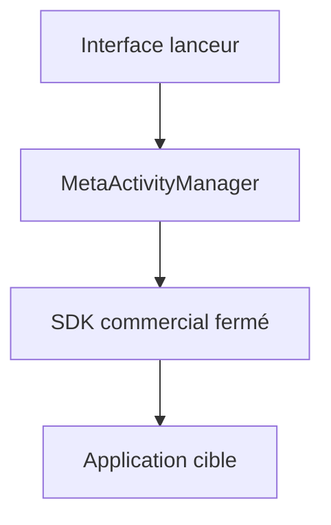

# Katana-Official/SPatch-Update

> Interface de lanceur Android pour conteneur d'applications, dont le SDK complet est commercial.

## Le problème
Exécuter des applications clonées ou modifiées dans un conteneur Android demande un SDK que ce dépôt ne fournit pas.

## Ce que ça fait vraiment
Une interface d'exemple fondée sur le projet Mundo, qui appelle `MetaActivityManager.launchApp` pour lancer une application. Le SDK est fermé et vendu. Le README fait la publicité de SlimVXposed (clonage d'applications, usurpation d'infos d'appareil) et de SPatch (modification d'applications Android et iOS).

## Comment c'est branché
Schéma simplifié d'après la fiche, sans diagramme fourni.



## Essayer
```java
MetaActivityManager.launchApp(
    applicationPackageName
);
```
Le SDK doit d'abord être placé au bon endroit, après contact avec l'auteur.

## Coût et pièges
Le SDK est payant et non ouvert. Contact par courriel et Telegram ; la licence est présente mais non identifiée par GitHub. Le README annonce aussi des services de réhabillage de marque.

## Ce que ce n'est pas
Pas un projet libre complet : l'interface seule ne compile pas sans le SDK. Pas un outil de data ni d'IA.

## Alternatives
Aucune citée dans le README.

## Pour toi
À ignorer : dépôt commercial déguisé, sans SDK utilisable ni lien avec ton métier, avec une licence floue.

