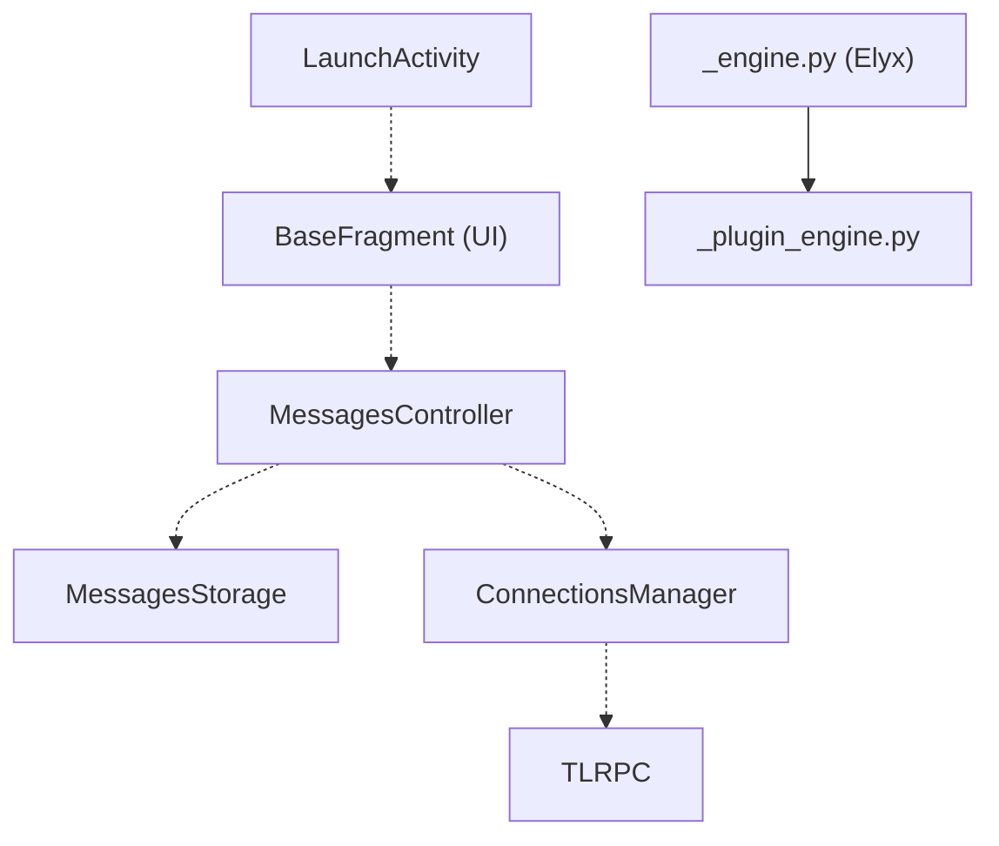

# Keeperorowner/NagramXF

> Android fork of the Nagram X Telegram client, with features taken from exteraGram and AyuGram.

## The problem
The official Telegram client lacks some customizations and advanced features.

## What it actually does
An Android Telegram client (TMessagesProj) with additions: a bookmark manager, web search, group call messages, localization, and a Python plugin engine called "Elyx". The diagram notes that the full chain is not verified in the excerpts provided. Part of the code comes from reverse engineering of closed projects.

## How it is wired


## Trying it
```bash
git clone --recursive --shallow-submodules https://github.com/Keeperorowner/NagramXF.git NagramXF
git submodule update --init --recursive --depth=1
```

## Cost and gotchas
Free. Building requires Android Studio, Telegram API credentials, a keystore and a google-services.json file.

## What it is not
Not an official client. A third-party client handles your messages: use it knowingly.

## Alternatives
NagramX, AyuGram, Cherrygram, exteraGram and OctoGram, cited in the acknowledgements.

## For you
Ignore: a messaging client, unrelated to data / AI / MLOps work, and trusting a third-party fork is a risk.
