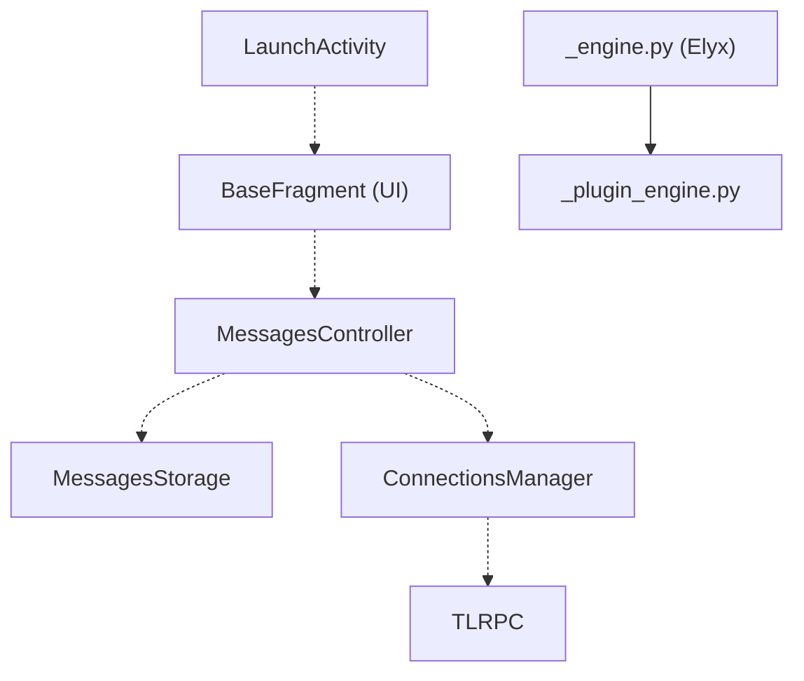

# Keeperorowner/NagramXF

> Fork Android du client Telegram Nagram X, avec des fonctions reprises d'exteraGram et AyuGram.

## Le problème
Le client Telegram officiel n'offre pas certaines personnalisations ni fonctions avancées.

## Ce que ça fait vraiment
Un client Telegram Android (TMessagesProj) avec ajouts : gestionnaire de signets, recherche web, messages d'appel de groupe, localisation, et un moteur de plugins Python « Elyx ». Le diagramme indique que la chaîne complète n'est pas vérifiée dans les extraits fournis. Une partie du code vient d'ingénierie inverse de projets fermés.

## Comment c'est branché


## Essayer
```bash
git clone --recursive --shallow-submodules https://github.com/Keeperorowner/NagramXF.git NagramXF
git submodule update --init --recursive --depth=1
```

## Coût et pièges
Gratuit. Compiler exige Android Studio, des identifiants API Telegram, un keystore et un fichier google-services.json.

## Ce que ce n'est pas
Pas un client officiel. Un client tiers manipule tes messages : à utiliser en connaissance de cause.

## Alternatives
NagramX, AyuGram, Cherrygram, exteraGram et OctoGram, cités en remerciements.

## Pour toi
Ignorer : client de messagerie, sans lien avec un travail data / IA / MLOps, et la confiance accordée à un fork tiers est un risque.

