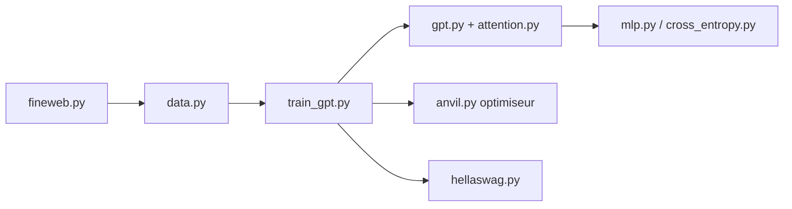

# KellerJordan/modded-nanogpt

> Collaborative speedrun to train a GPT-2 small on FineWeb in minimum time on 8 H100s.

## The problem
Papers on LLM training each use their own testbed, which makes it impossible to know which techniques really work.

## What it actually does
A PyTorch training script that reaches a validation loss of 3.28 on FineWeb in a little over a minute on 8 H100s (record 91 at 1.126 minutes), versus 45 minutes for llm.c. It stacks the Muon optimizer, FP8, FlashAttention 3 attention with sliding windows, value embeddings, Triton kernels. A second tier targets GPT-2 Medium (2.92). Strict rules govern new records.

## How it is wired


## Trying it
```bash
git clone https://github.com/KellerJordan/modded-nanogpt.git && cd modded-nanogpt
pip install -r requirements.txt
python data/cached_fineweb10B.py 9
./run.sh
```

## Cost and gotchas
Records are timed on 8 H100s (rental at PrimeIntellect cited). `torch.compile` adds about 7 minutes on the first run. Docker recommended for precise timing.

## What it is not
Not a reusable training framework nor a model to deploy. The README admits that some tricks will not scale.

## Alternatives
llm.c (baseline, 45 minutes); forks modded-nanogpt-rwkv and modded-nanogpt-SOAP for other architectures and optimizers.

## For you
Adopt as a source of ideas: the best dated catalog of efficient training techniques, to read more than to run for lack of 8 H100s.
